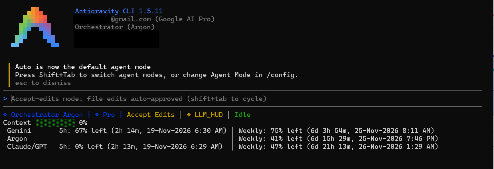

# LLM_HUD

Passive status-line HUDs and quota companions for Antigravity CLI, Codex CLI, and OpenCode TUI.

## Components in This Repository

1. **`agy-hud` (`0.2.0-passive`)** (`src/`, `dist/agy-hud.js`, `hooks/`): Strictly passive Antigravity CLI status-line HUD rendering model, context occupancy, workspace/git metadata from stdin, and horizontally grouped `5h` and `Weekly` remaining quota with countdowns and local reset date/time. See [Windows Install & Rollback](docs/WINDOWS_INSTALL_AND_ROLLBACK.md), [Security Review](docs/SECURITY_REVIEW.md), and [Quota Payload Compatibility](docs/QUOTA_PAYLOAD_COMPATIBILITY.md).
2. **`codex-hud` & Windows Desktop Widget** (`codex/`, `dist/codex-hud.js`): Codex CLI quota terminal companion and dark rounded Windows desktop card widget (`Codex Quota` header, `5 Hour` / `Weekly` color-coded bars, custom tray icon, and persistent size & position). See [Codex Quota Companion](docs/CODEX-HUD.md).
3. **`opencode-hud`** (`opencode-hud/`): OpenCode TUI footer plugin showing OpenCode Go/Zen 5h, weekly, and monthly quota/budget. See [opencode-hud README](opencode-hud/README.md).

---

## agy-hud (`0.2.0-passive`)

`agy-hud` reads a single bounded (`1 MiB`) Antigravity status-line JSON object from `stdin`, formats it with pure functions and optional CLI flags, writes the rendered status line to `stdout`, and exits.



`0.2.0-passive` is **strictly passive**:

- **Zero network requests, zero subprocesses, and zero filesystem reads or writes.**
- Never invokes `agy -p /usage`, never probes loopback servers, never reads `.git/HEAD`, never reads `config.json` or quota cache files, and never accesses credential stores.
- Configured entirely via CLI flags and the `stdin` JSON payload.

### Requirements

- Antigravity CLI 1.1.0 or newer (wired with `/statusline`).
- Node.js 18 or newer. On macOS/Linux, `hooks/status-line.sh` locates Node under common version managers (`Volta`, `nvm`, `fnm`, `mise`, `asdf`, `nodenv`, `n`, `Homebrew`, and system paths) if `node` is not on `PATH`. On Windows, `hooks/status-line.cmd` resolves `node.exe` via `PATH` (skipping the current working directory) and standard install directories.
- macOS, Linux, or Windows.
- Optional Nerd Font glyphs; pass `--no-icons` for plain-text output without a Nerd Font.

### Install From Local Path

Do not pass a git clone straight to `agy plugin install`. The command copies the entire directory, including `.git/` and source files, and aborts if `.git/fsmonitor--daemon.ipc` is present.

Stage the release file set first, then install the staged directory:

```sh
npm ci && npm run build && npm test

stage=$(mktemp -d)/agy-hud
mkdir -p "$stage/hooks" "$stage/dist" "$stage/docs"
cp plugin.json config.example.json README.md LICENSE THIRD_PARTY_NOTICES.md SECURITY.md CONTRIBUTING.md CHANGELOG.md "$stage/"
cp hooks/status-line.sh hooks/status-line.cmd "$stage/hooks/"
cp dist/agy-hud.js "$stage/dist/"
cp docs/hud-preview.png "$stage/docs/"

agy plugin validate "$stage"
agy plugin install "$stage"
```

After installing, wire the status line inside Antigravity CLI:

On macOS/Linux:

```text
/statusline ~/.gemini/config/plugins/agy-hud/hooks/status-line.sh
```

On Windows (use 8.3 short paths without quotes if `%USERPROFILE%` contains spaces; see [Windows Install & Rollback](docs/WINDOWS_INSTALL_AND_ROLLBACK.md)):

```text
/statusline %USERPROFILE%\.gemini\config\plugins\agy-hud\hooks\status-line.cmd
```

### Expected Release Install Shape

GitHub releases publish a platform-independent archive:

- `agy-hud.tar.gz`

The archive contains `plugin.json`, `hooks/status-line.sh`, `hooks/status-line.cmd`, `dist/agy-hud.js`, `config.example.json`, `README.md`, `LICENSE`, `THIRD_PARTY_NOTICES.md`, and supporting docs. Runtime dependencies are bundled, so no `npm install` is required after extraction.

### CLI & Flags

Run the bundled script directly with Node.js 18+:

```sh
node <plugin-root>/dist/agy-hud.js statusline < statusline_payload.json
node <plugin-root>/dist/agy-hud.js version
node <plugin-root>/dist/agy-hud.js doctor
node <plugin-root>/dist/agy-hud.js doctor --json
```

`statusline` starts as soon as `stdin` holds a complete JSON object and times out after `1000 ms` by default if `stdin` remains open without valid JSON.

Supported `statusline` flags:

- `--color` / `--no-color`: Enable or disable ANSI colors (default: enabled).
- `--icons` / `--no-icons`: Enable or disable Nerd Font icons (default: enabled).
- `--bar` / `--no-bar`: Show or hide context progress bar (default: enabled).
- `--multiline` / `--single-line`: Two-line or single-line layout (default: two-line).
- `--no-git`, `--no-cwd`, `--no-state`, `--no-cost`, `--no-mode`: Hide individual segments.
- `--show-title` / `--no-title`: Show or hide sanitized `conversation_title` (default: hidden).
- `--context-value=percent|tokens|both`: Context occupancy display mode (default: `percent`).
- `--usage-value=remaining|percent`: Quota display mode (default: `remaining`).
- `--locale=<bcp47>`: Override locale for absolute reset timestamps (default: OS locale).
- `--time-zone=<iana>`: Override IANA timezone for reset timestamps (default: OS timezone).
- `--stdin-timeout-ms=<50..10000>`: Stdin read timeout in milliseconds (default: `1000`).

`doctor` performs a passive in-memory check of the Node version, OS locale/timezone, and terminal icon probe without reading config files or spawning external tools.

### Icons Render As Boxes

The HUD uses four Nerd Font Private Use Area glyphs (model, plan, git branch, folder). If your terminal font lacks them, either:

1. Pass `--no-icons` in your `/statusline` command to render plain text, or
2. Configure a Nerd Font in your terminal profile (for example Hack Nerd Font).

Run `node <plugin-root>/dist/agy-hud.js doctor` inside your terminal to check the icon probe.

### Node Is Not Found

When Antigravity CLI starts `hooks/status-line.sh` without a shell profile, the hook searches common Node 18+ installations (`Volta`, `nvm`, `fnm`, `mise`, `asdf`, `nodenv`, `n`, `Homebrew`, and system directories) and appends the discovered directory to `PATH`. It skips Volta/mise shims and checks directly for installed binaries.

On Windows, `hooks/status-line.cmd` locates `node.exe` via `%~$PATH:i` (ignoring the current working directory unless `.` is explicitly in `PATH`) and standard `Program Files` / `LocalAppData` install paths. If Node is still not found, wire `/statusline` to the full path of `node.exe` (using 8.3 short paths if needed, without quotes).

### Uninstalling

Remove the `/statusline` command inside Antigravity CLI, then uninstall the plugin:

```text
/statusline delete
```

```sh
agy plugin uninstall agy-hud
```

## Privacy And Security

See [SECURITY.md](SECURITY.md) and [docs/SECURITY_REVIEW.md](docs/SECURITY_REVIEW.md) for the security model of `agy-hud`, `codex-hud`, and `opencode-hud`.

## Development

```sh
npm ci
npm run build
npm test
npm run lint
```

`npm run build` bundles `src/main.ts` into `dist/agy-hud.js` and `codex/src/main.ts` into `dist/codex-hud.js`. Commit rebuilt bundles alongside TypeScript changes.
